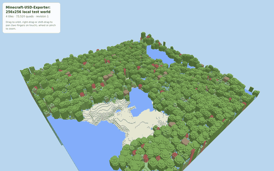
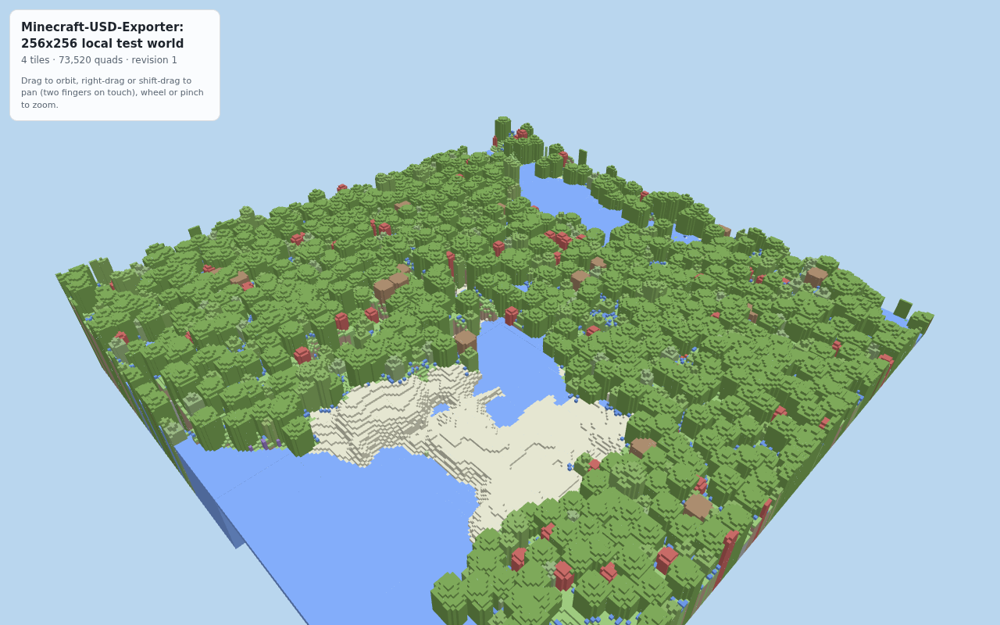
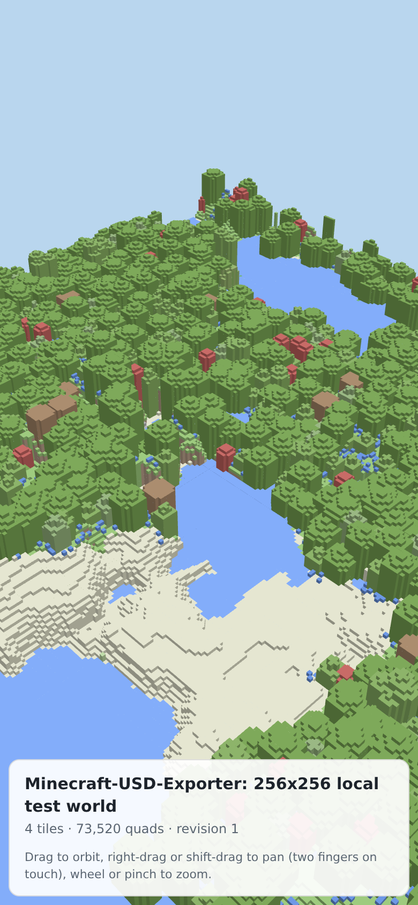
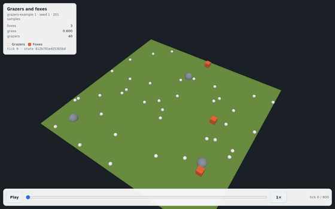
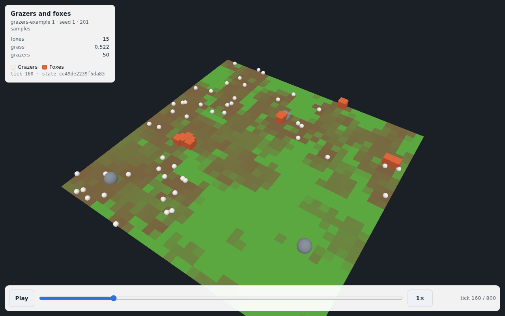
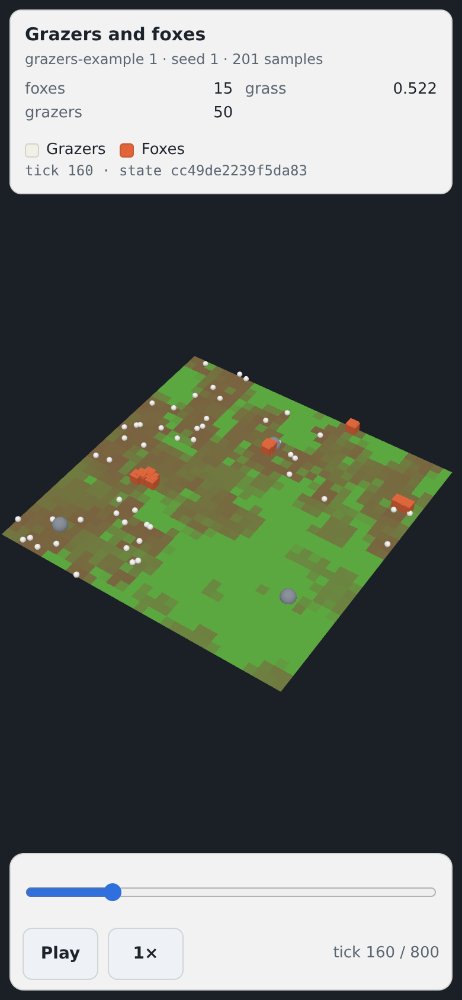

# usd-web

Put an OpenUSD world on a web page. `usd-web` reduces a USD stage (its `PointInstancer`
terrain) or a plain heightmap to its top surface, greedy-meshes it into compact, chunk-aligned
binary tiles with a versioned `index.json`, and ships a dependency-free three.js viewer module
that draws them — orbit/pan/zoom with touch, overlay layers with a legend and labels,
billboard sprites, and live tile hot-swapping while the tiles are republished.



*The bundled viewer (`viewer/index.html`) drawing 4 tiles / 73,520 quads that `usd-web tiles` built from a
[Minecraft-USD-Exporter](https://github.com/Dans-Plugins/Minecraft-USD-Exporter) export of a 256x256-block
area of a local test world, orbited by mouse drag in headless Chromium.*

```text
stage.usdc ─┐                               ┌─ index.json      (versioned, written last)
            ├─ top surface ─ greedy mesh ───┤
heightmap ──┘                               └─ t.X.Z.<hash>.uwt (gzip, content-addressed)
                                                     │
                       viewer/usd-web-viewer.js ◄────┘  (polls index.json, swaps changed tiles)
```

It was generalised from two viewers in this project family — Roam's 3D spectator and a
voxel-world map built on [Minecraft-USD-Exporter](https://github.com/Dans-Plugins/Minecraft-USD-Exporter)
output — so the next project does not have to write a third one. Nothing in it is specific to
a game: overlays are generic layers of cells with a label and a colour.

| Desktop (1280x800) | Phone (390x844) |
|---|---|
|  |  |

The tile set was built with
`usd-web tiles world.usda -o site/tiles --tile-size 128 --exclude short_grass --exclude tall_grass`
and served next to the two viewer files; [`docs/capture_readme.py`](docs/capture_readme.py) takes
the screenshots and the orbit GIF from any served tile set (Playwright + Pillow, WebGL on
SwiftShader).

## Replays

`usd-web replay` turns a simulation replay in usd-recorder's
[`usd-replay/1` contract](https://github.com/Preponderous-Software/usd-recorder/blob/main/docs/REPLAY.md)
(entities as time-sampled `Points`, colour-grid fields, a state hash per sample) into a small
static web replay, and `viewer/usd-web-replay.js` plays it: a timeline scrubber, play/pause,
speed (0.25× to 8×), drag/pinch orbit, and the state hash of the tick on screen.



| Desktop (1280x800) | Phone (390x844) |
|---|---|
|  |  |

*usd-recorder's `examples/grazers_replay.py` (800 ticks, 201 samples, 2.6 MB `.usdc`) became a
118 KB web replay. Captured with [`docs/capture_replay.py`](docs/capture_replay.py) in headless
Chromium.*

```bash
usd-web replay run.usdc -o site/replay --max-samples 300   # replay.json + gzip'd chunks
cp viewer/replay.html viewer/usd-web-replay.js site/
python -m http.server -d site 8000      # open http://localhost:8000/replay.html?data=replay/
```

Positions are quantized to 16 bits over the replay's bounds and ids renumbered densely, so a
replay of a thousand entities over a few hundred samples is typically a few hundred KB. Chunks
are fetched in order and playback starts on the first one. Embedding the player:

```html
<canvas id="view"></canvas><div id="bar"></div>
<script type="module">
  import * as THREE from "https://cdn.jsdelivr.net/npm/three@0.160.0/build/three.module.js";
  import { createReplayPlayer } from "./usd-web-replay.js";
  const player = createReplayPlayer({ THREE, canvas: document.getElementById("view"),
                                      baseUrl: "replay/", controls: document.getElementById("bar") });
  await player.ready;
</script>
```

## Install

```bash
pip install "usd-web @ git+https://github.com/Preponderous-Software/usd-web@v0.2.2"
```

Python 3.11+, `usd-core` 26.8 and numpy. The viewer and the replay player are static files in
[`viewer/`](viewer/); copy them next to your tiles or replay.

## Quick start

From a USD stage with `PointInstancer` prims (Y-up or Z-up):

```bash
usd-web tiles world.usdc -o site/tiles --exclude short_grass --title "My world"
cp viewer/index.html viewer/usd-web-viewer.js site/
python -m http.server -d site 8000   # open http://localhost:8000/?data=tiles/
```

From Python, with a heightmap:

```python
import numpy as np
from usd_web import Palette, Surface, build_tiles, publish

palette = Palette(["#3b6fb6", "#5a9e4b"])            # water, grass
heights = np.random.default_rng(0).integers(4, 12, size=(256, 256))
colors = (heights > 5).astype(int)
tiles = build_tiles(Surface.from_heightmap(heights, colors), tile_size=128, chunk_size=16)
publish("site/tiles", tiles, palette, layers=[{
    "id": "zones", "label": "Zones", "kind": "cells", "cellSize": 16, "labels": True,
    "entries": [{"label": "Camp", "color": "#e0553d", "cells": [[2, 2], [2, 3]]}],
}])
```

Republishing only the tiles that changed is incremental and atomic: open viewers pick up the
new tiles on their next poll. Try it with the demo:

```bash
python examples/make_demo.py viewer/demo
python -m http.server -d viewer 8000          # open http://localhost:8000/?poll=1
python examples/make_demo.py viewer/demo --bump 1   # one tile changes in the open page
```

Embedding the viewer in your own page:

```html
<canvas id="view"></canvas>
<script type="module">
  import * as THREE from "https://cdn.jsdelivr.net/npm/three@0.160.0/build/three.module.js";
  import { createViewer } from "./usd-web-viewer.js";
  const viewer = createViewer({ THREE, canvas: document.getElementById("view"), baseUrl: "tiles/" });
  await viewer.ready;
</script>
```

`usd-web inspect <dir|index.json|tile.uwt>` prints a summary of a tile set or a tile.

## Documentation

- [CONCEPT.md](CONCEPT.md) — what it is for and what it deliberately is not.
- [ARCHITECTURE.md](ARCHITECTURE.md) — tile format, index schema and versioning, atomic
  publish, the viewer module API, three.js pinning.
- [docs/MIGRATING.md](docs/MIGRATING.md) — moving an existing hand-written viewer onto usd-web.

## Development

```bash
uv venv -p 3.12 && uv pip install -e ".[dev]"
python -m pytest                     # unit tests (the JS decoder test needs node)
uv pip install -e ".[browser]" && python -m playwright install chromium
python -m pytest -m browser          # viewer + replay smoke tests (headless Chromium + SwiftShader)
```

## License

[MIT](LICENSE) © 2026 Daniel McCoy Stephenson
